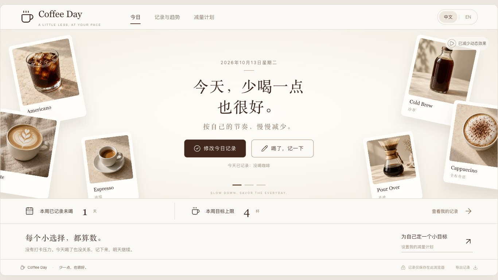
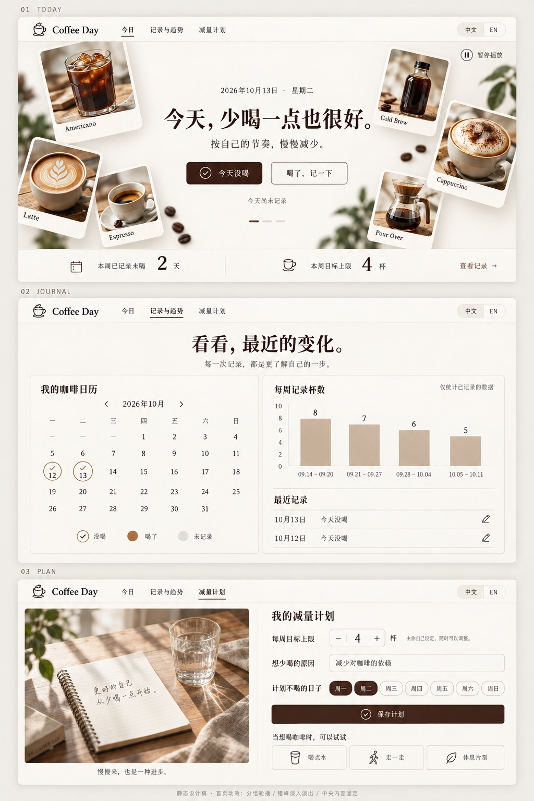
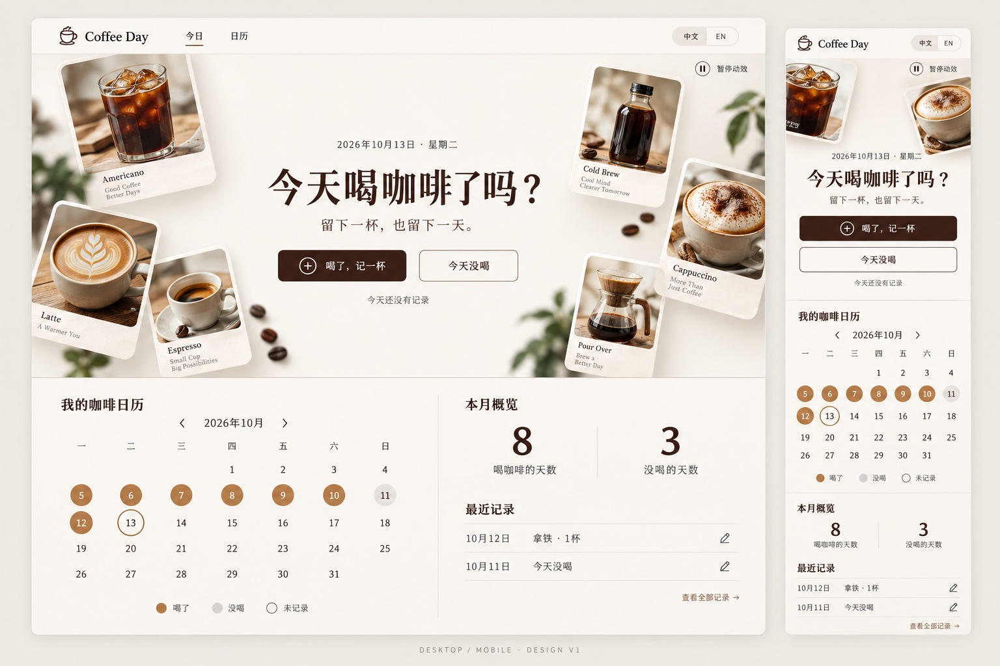
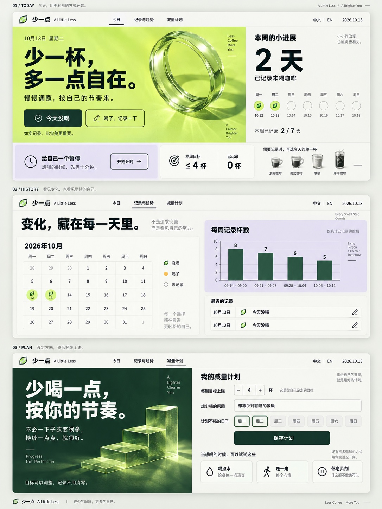
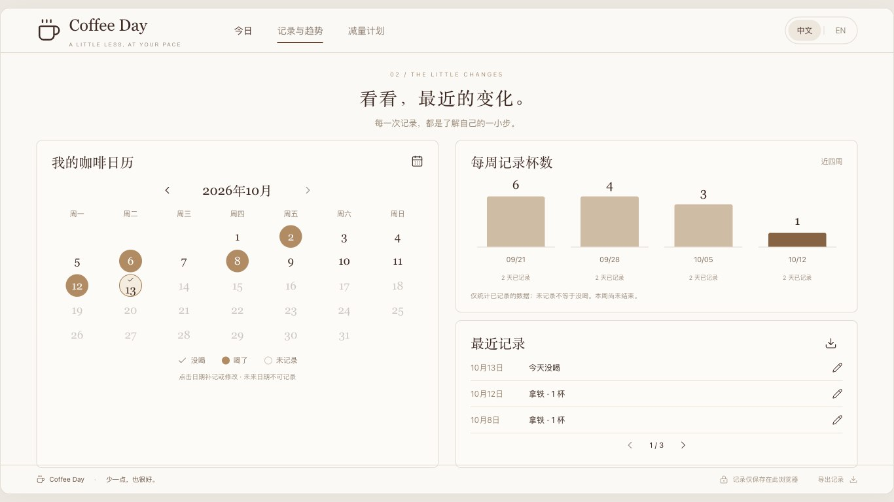
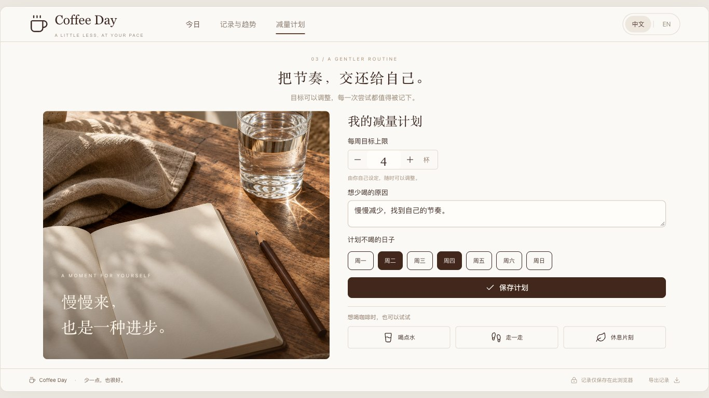
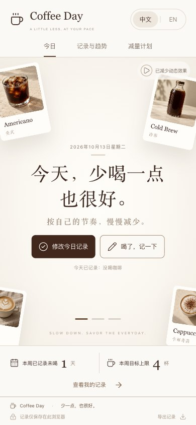
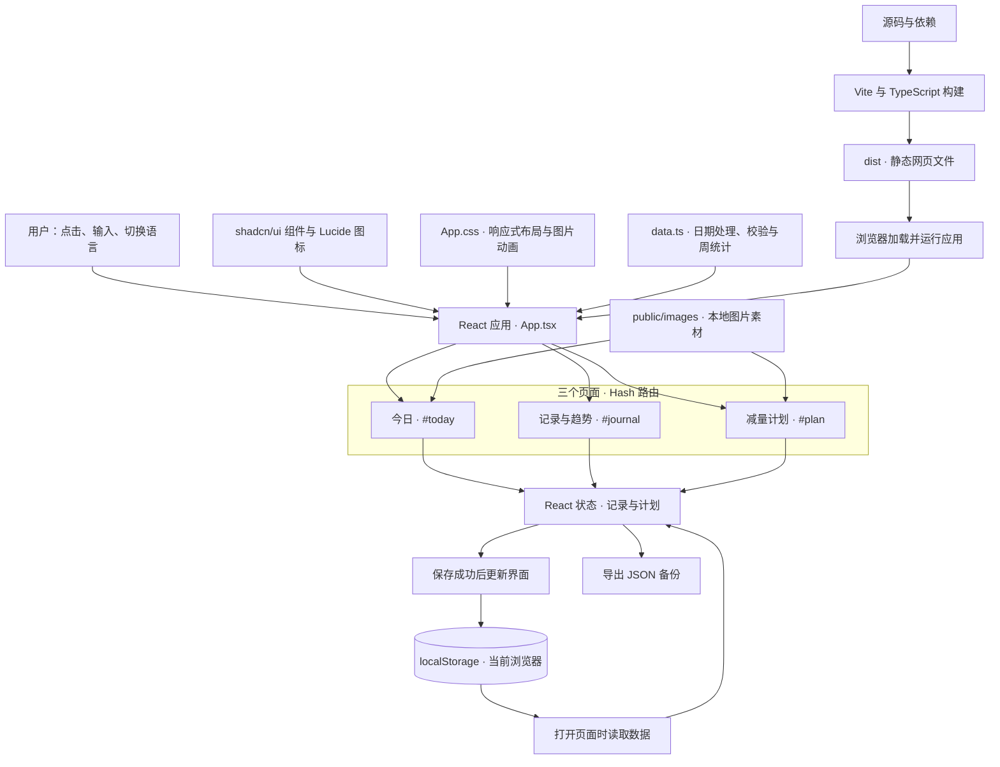

# Coffee Day

### 今天，少喝一点也很好。

一个帮助你慢慢减少咖啡的中英文记录网页：记下每一天，回顾变化，再为自己设定一个小目标。

[UI 原型](#ui-原型) · [功能与网页截图](#功能与网页截图) · [架构图](#架构图) · [图片素材](#图片素材) · [启动项目](#启动项目) · [提交记录](https://github.com/summerYYang0622/coffee-day/commits/main/)



> 上图和下方网页截图来自实际运行的应用，使用独立测试环境中的演示记录，不是用户的真实数据。首次打开应用时，记录为空。

## UI 原型

最终采用第三版方案：奶油白背景、咖啡棕文字、照片卡片和充足留白。保留咖啡主题，同时把“今天没喝”放在主要操作位置，让产品服务于“少喝一点”的目标。



**原型与实物的区别：** 原型用于确认视觉方向；实际网页进一步压缩了高度，并增加了记录分页，使常见桌面窗口中的三个页面能够一屏显示。

<details>
<summary>展开查看第一版、第二版设计探索</summary>

### 第一版：确定奶油白与咖啡棕的视觉风格



### 第二版：探索减量主题和三个页面



第二版的多色方案未被采用。最终保留三个页面的功能结构，回到第一版的简洁配色。

</details>

## 功能与网页截图

### 1. 今日：轻松记下一天

- 点击“今天没喝”完成记录；已有记录时可以修改。
- 喝了咖啡时，选择种类、杯数，并填写可选备注。
- 查看本周已记录的未喝天数和每周目标。
- 咖啡图片分组移动、错峰淡入淡出；中央标题与按钮固定。
- 支持暂停和手动切换场景；系统开启“减少动态效果”时显示静态画面。


动画由三组图片组成，每组约 6 秒，完整循环约 18 秒。组内图片错开 90 毫秒进入，避免所有图片同时出现。截图只展示其中一个静态状态。

### 2. 记录与趋势：了解自己的习惯

- 点击月历中的日期补记或修改，不允许记录未来日期。
- 区分“喝了”“没喝”“未记录”，未记录不会算作没喝。
- 查看近四周已记录的杯数，以及每周记录了多少天。
- 最近记录每页显示 3 条，使用左右按钮翻页。
- 支持导出 JSON 备份；当前周会注明尚未结束。



### 3. 减量计划：按自己的节奏来

- 自定义每周杯数目标。
- 写下想少喝的原因。
- 选择计划不喝咖啡的星期。
- 保存后刷新页面，计划仍会保留。



计划是用户自己的安排，不会发送通知。较矮的桌面窗口会收起辅助文案，优先保留主要操作。

### 4. 中英文与手机适配

右上角可以切换中文 / English。桌面端采用并排布局，手机端重排为单列；手机首页适配窗口高度，记录页和计划页允许自然滚动。

<p align="center">
  
</p>

## 架构图

这是一个**运行在浏览器里的前端应用**，目前没有独立后端、账号系统或云数据库。



上面的三个页面节点，对应前面的三张网页截图。可以这样理解整个过程：**用户操作页面 → 更新记录或计划 → 保存到浏览器 → 下次打开时读取**。统计由本地记录计算，不请求远端数据。

| 部分 | 对应代码 | 用途 |
| --- | --- | --- |
| 页面与交互 | [src/App.tsx](src/App.tsx) | 三个页面、记录弹窗、语言切换和保存 |
| 样式与动画 | [src/App.css](src/App.css) | 配色、一屏布局、手机适配和卡片动画 |
| 数据逻辑 | [src/lib/data.ts](src/lib/data.ts) | 读取记录、日期校验、每周统计 |
| 基础组件 | [src/components/ui](src/components/ui) | Button、Dialog、Input、Textarea |
| 本地素材 | [public/images](public/images) | 页面使用的咖啡图片和静物照片 |
| 构建配置 | [vite.config.ts](vite.config.ts) | 开发预览和正式构建 |

## 图片素材

网页使用的图片由内置 ImageGen 生成，已经和源码一起保存在仓库中。网页直接读取本地图片文件，不依赖外部图片网址。

### 六种咖啡图片

从左到右、从上到下分别是：**美式、拿铁、浓缩、冷萃、卡布奇诺、手冲**。页面通过 CSS 背景位置，从这张网格图中显示对应的咖啡。


[打开咖啡图片原文件](public/images/coffee-atlas.jpg)

### 计划页静物照片

笔记本、水杯与自然光，用于表达缓慢调整、给自己留一点时间。

<p align="center">
  
</p>

[打开静物照片原文件](public/images/quiet-moment.jpg) · [查看生成提示词](ASSETS.md) · [查看全部原型与截图](docs/images)

素材采用 JPEG 版本以减小文件体积；原型图、网页截图与页面素材分别命名，方便查找和替换。

## 启动项目

建议使用 **Node.js 24 与 pnpm 11**，与自动检查环境一致。

### 在这台 Mac 上运行

打开终端，依次执行：

```bash
# 进入项目目录
cd "/Users/clh/Documents/ChatGPT/coffee_day"

# 安装依赖
pnpm install

# 生成网页
pnpm build

# 启动本地预览
pnpm preview --host 127.0.0.1 --port 4173
```

打开 **[http://127.0.0.1:4173/](http://127.0.0.1:4173/)**。浏览期间保持终端运行；按 `Ctrl+C` 会停止服务。

下次只需进入目录并运行预览命令。修改代码后，需要重新执行 `pnpm build`；开发过程中也可以用 `pnpm dev` 自动刷新页面。

### 在另一台电脑上运行

先使用有权限的 GitHub 账号克隆私有仓库，再安装依赖和启动：

```bash
git clone https://github.com/summerYYang0622/coffee-day.git
cd coffee-day
pnpm install
pnpm build
pnpm preview --host 127.0.0.1 --port 4173
```

## 常见问题

**为什么提示“127.0.0.1 拒绝连接”？**  
本地服务没有运行。回到终端，执行启动预览命令。

**记录保存在哪里？**  
保存在当前浏览器和当前网址下，刷新后仍在。不同设备、浏览器、域名或端口之间不会自动同步；清除网站数据可能丢失记录。页脚支持导出 JSON，当前没有导入界面。

**可以分享网页地址给别人吗？**  
目前代码已提交 GitHub，网页在本机运行。`127.0.0.1` 指向访问者自己的电脑；要公开访问，需要另外部署网页。

**在哪里查看代码提交？**  
打开 [main 分支](https://github.com/summerYYang0622/coffee-day/tree/main) 或 [全部提交记录](https://github.com/summerYYang0622/coffee-day/commits/main/)。私有仓库需要登录有访问权限的账号。

## 检查与开发文档

```bash
pnpm test    # 日期与统计逻辑测试
pnpm build   # TypeScript 检查和正式构建
```

项目还通过 Chromium 和 WebKit 手机触屏环境检查过打卡、修改、刷新保存、语言切换、计划设置与导出。

[开发过程与实际使用的命令](docs/DEVELOPMENT.md) · [图片生成提示词](ASSETS.md) · [自动检查配置](.github/workflows/check.yml)
